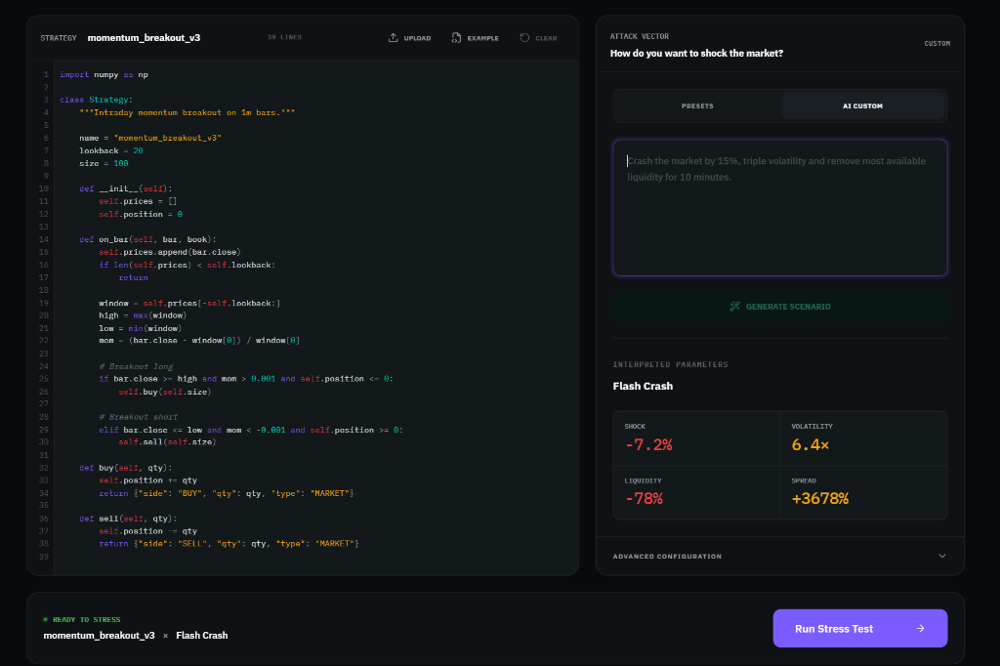

<div align="center">

# ⚡ StressTest

### Stop backtesting on the past. Stress-test against the unknown.

An AI market simulator that turns a plain-English shock — *"ECB emergency hike, EUR/USD spread blows out to 65 pips, bid depth evaporates 94%"* — into a tick-level synthetic market, then runs your trading strategy through it and tells you exactly where it breaks.




</div>

---

## The problem

Quant strategies are validated on historical data, but the events that blow them up — flash crashes, liquidity freezes, venue outages, feed stalls — are precisely the ones history doesn't contain enough of. A strategy that looks great in backtest can divide by zero when volume hits 0, or loop forever when a websocket freezes.

## What StressTest does

1. **Interpret** — an LLM reads your scenario and compiles it into a structured *market script*: typed events (shocks, volatility regimes, liquidity withdrawal, spread widening, halts, outages…) with real parameters.
2. **Simulate** — a deterministic engine plays that script out as a tick-by-tick order book, streaming every tick and market event to the UI over SSE.
3. **Execute** — your strategy runs in a sandboxed subprocess against that market, with fills, slippage and P&L computed by the engine.
4. **Audit** — an LLM reads the run (and your code) and produces a risk report: where it failed, why, and how severe.
5. **Improve** — it proposes a patched strategy and a diff you can re-run against the same shock.

The LLM never invents prices directly. It only produces a *script*, and the engine does the math — so runs are reproducible and the numbers are checkable.

## Architecture

```
┌──────────────────────┐   SSE / JSON    ┌───────────────────────────────────────┐
│  Next.js 16 frontend │ ◄─────────────► │            FastAPI backend            │
│  Tailwind · Framer   │                 │                                       │
│  Code editor · charts│                 │  routers/   scenarios · simulations   │
└──────────────────────┘                 │             audits · strategies · …   │
                                         │  llm/       interpret · audit · improve│
                                         │  engine/    book · market · runner    │
                                         │             sandbox · safeexec · metrics│
                                         └───────────────┬───────────────────────┘
                                                         │ OpenAI-compatible client
                                                         ▼
                                              Nebius Token Factory (Qwen3 …)
```

| Layer | Highlights |
|---|---|
| `backend/llm/` | Prompt → structured scenario; vocabulary normalisation; automatic repair of malformed model output; audit & improvement generation |
| `backend/engine/` | Event-driven order-book simulator, strategy runner, risk metrics, run store |
| `backend/engine/sandbox.py` + `safeexec.py` | Strategies execute in a separate process with an import allowlist, stripped builtins and a wall-clock timeout |
| `backend/contracts/` | Pydantic v2 models for every request/response — the typed contract the frontend builds against |
| `backend/benchmarks/` | Hand-labelled scenarios scored for event recall and parameter accuracy, used to compare models |
| `backend/auth.py` | Shared-secret `X-API-Key` guard on `/api/*` (opt-in via env var) |

### API surface

| Method | Route | Returns |
|---|---|---|
| `GET` | `/health` | liveness + whether a key is required |
| `POST` | `/api/scenarios/interpret` | Prompt → structured market script with reasoning |
| `POST` | `/api/simulations` | **SSE stream** of ticks, market events, final run |
| `POST` | `/api/simulations/sync` | Same result as a single JSON payload |
| `POST` | `/api/audits` | Risk audit of a run |
| `POST` | `/api/strategies/improve` | Patched strategy + diff |
| `POST` | `/api/strategies/adapt` | Adapter so third-party strategy shapes can run |
| `GET` | `/api/runs` | Past runs |
| `GET` | `/api/benchmark` | Stored model benchmark results |

Interactive docs live at `/docs` when the server is running.

## Model benchmark

Scenario interpretation is scored against hand-labelled ground truth (labels were written *before* any model was run). Latest stored results across five scenarios — equity flash crash, liquidity freeze, ECB FX microstructure, crypto venue outage, gilt rates spiral:

| Model | Score | Event recall | Param accuracy |
|---|---|---|---|
| Qwen3-30B-A3B-Instruct | 94.8 | 95% | 91% |
| Qwen3-235B-A22B-Instruct | 97.2 | 95% | 96% |

Re-run it yourself: `cd backend && python -m benchmarks.run`

## Running it locally

**Backend** (Python 3.11+)

```bash
cd backend
python -m venv venv && source venv/bin/activate   # Windows: venv\Scripts\activate
pip install -r requirements.txt

cp .env.example .env        # or create .env yourself — see below
uvicorn main:app --reload --port 8000
```

`backend/.env`:

```ini
NEBIUS_API_KEY=your-nebius-token-factory-key
# Optional: require X-API-Key on /api/* (strongly recommended on any public URL)
STRESSTEST_API_KEY=pick-a-long-random-string
```

Then open <http://localhost:8000> for the built-in dashboard, or `/docs` for the API explorer.

**Frontend**

```bash
cd frontend
npm install
npm run dev
```

> No API key handy? `backend/static/fixtures.json` holds captured real responses for every endpoint, and the legacy `/api/backtest` endpoint accepts `use_mock`, so the UI can still be explored offline.

## Security notes

- Secrets are only ever read from environment variables; `.env` files are git-ignored.
- Strategy code is untrusted. The sandbox (separate process, import allowlist, restricted builtins, hard timeout) stops accidents and casual misuse, **but it is not a hardened jail** — anything exposed publicly should run inside container/seccomp isolation and behind `STRESSTEST_API_KEY`.

## Project status

Built for the **Accel AI Innovate Hackathon** on Nebius Token Factory. This is a showcase / prototype: the core pipeline works end to end, but expect rough edges.

## Tech stack

**Backend:** Python · FastAPI · Pydantic v2 · NumPy · OpenAI-compatible SDK → Nebius Token Factory
**Frontend:** Next.js (App Router) · React 19 · TypeScript · Tailwind CSS 4 · Framer Motion · Lucide
**Deploy targets:** Vercel · Fly.io · Modal
